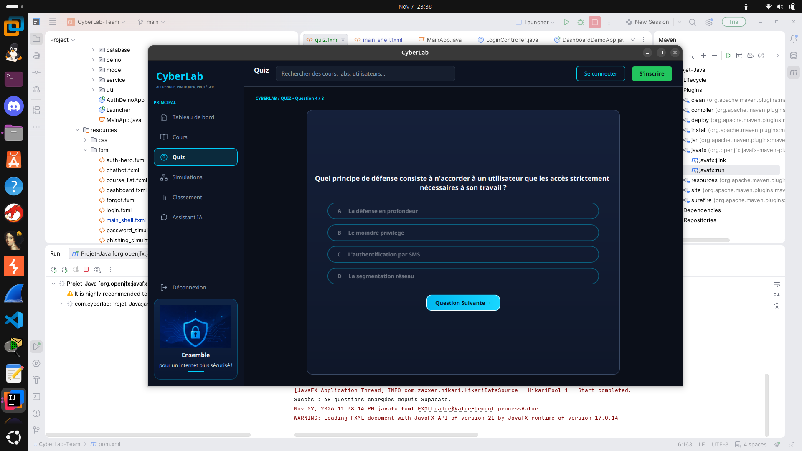
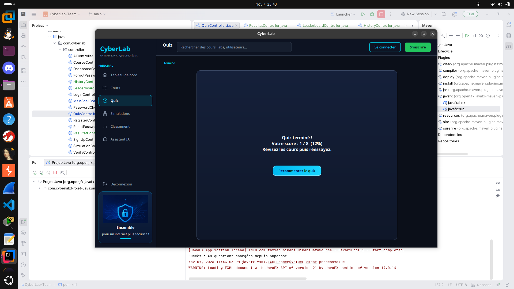

# CyberLab

Application de bureau (JavaFX) pour **apprendre la cybersécurité** : cours, quiz chronométrés, simulations de phishing, vérificateur de mot de passe, classement et assistant IA.

> Projet réalisé en équipe — slogan : *Apprendre, pratiquer, protéger.*

## Captures d'écran

| Quiz | Résultat |
|---|---|
|  |  |

<!-- Ajouter ici : docs/screenshots/dashboard.png, cours.png, classement.png, historique.png -->

## Fonctionnalités

- **Authentification** : inscription, connexion, mot de passe oublié, vérification et réinitialisation.
- **Tableau de bord** : progression globale, score moyen, points, niveau, rang, série de jours, top 3 et cours en cours. Toutes les valeurs viennent de la base de données.
- **Cours** : contenu en Markdown, navigation Précédent / Suivant, suivi de progression, bouton **« Passer le quiz »** pour chaque cours.
- **Quiz par cours** :
  - choix du cours avant de commencer ;
  - **30 secondes** par question (une question sans réponse compte comme fausse) ;
  - questions et choix **mélangés** à chaque partie ;
  - correction immédiate (bonne réponse en vert, erreur en rouge) ;
  - le cours est validé automatiquement à partir de **50 %**.
- **Classement** : top 10, filtre par cours, badges *Meilleur score* et *Top 3*, votre rang.
- **Historique** : liste de vos quiz et **courbe de progression** (score en %).
- **Simulations** : détecteur de phishing et vérificateur de force de mot de passe.
- **Assistant IA** : questions sur les cours (Gemini, avec mode hors ligne intégré).

## Technologies

| | |
|---|---|
| Langage | Java 21 |
| Interface | JavaFX 21 (FXML + CSS) |
| Build | Maven (wrapper `mvnw` inclus) |
| Base de données | PostgreSQL hébergé sur Supabase (pool HikariCP) |
| IA | API Google Gemini |

## Installation

### 1. Prérequis
- JDK 21 (ou plus récent)
- Accès à la base Supabase du projet (demander les identifiants à l'équipe)

### 2. Configuration de la base de données
Copier le modèle puis le remplir avec les vrais identifiants :

```bash
cp db.properties.example db.properties
```

```properties
db.url=jdbc:postgresql://HOTE_DU_SESSION_POOLER:5432/postgres?sslmode=require
db.user=postgres.IDENTIFIANT_DU_PROJET
db.password=MOT_DE_PASSE
```

Les variables d'environnement `CYBERLAB_DB_URL`, `CYBERLAB_DB_USER` et `CYBERLAB_DB_PASSWORD` sont aussi acceptées.
`db.properties` est ignoré par Git : **ne jamais le publier**.

### 3. Tables de la base
Les scripts SQL sont dans le dossier `db/`. Pour les résultats de quiz, exécuter une fois `db/quiz_results.sql` dans le *SQL Editor* de Supabase.

| Table | Rôle |
|---|---|
| `users` | comptes utilisateurs |
| `courses` | cours (`id`, `titre`, `description`, `contenu`, `ordre`) |
| `progress` | cours terminés par utilisateur |
| `questions` | questions de quiz (`course_id`, `texte`, `choix_a` à `choix_d`, `bonne_reponse`) |
| `quiz_results` | score de chaque quiz passé (alimente classement, historique et dashboard) |

### 4. (Optionnel) Assistant IA
Définir la clé Gemini avant de lancer l'application :

```bash
export GEMINI_API_KEY="votre_cle"
```

Sans clé, l'assistant répond en **mode hors ligne** avec la base de connaissances des cours.

## Lancer l'application

```bash
./mvnw javafx:run
```

Dans IntelliJ : onglet **Maven** → *Plugins* → `javafx` → `javafx:run`.

## Structure du projet

```
src/main/java/com/cyberlab/
├── controller/   écrans (Login, Dashboard, Course, Quiz, Leaderboard, History, ...)
├── service/      logique métier et accès aux données (Quiz, Score, Progress, Dashboard, AI)
├── model/        objets métier (Course, Question, ...)
├── database/     connexion PostgreSQL (HikariCP)
└── util/         navigation (SceneManager), session, icônes

src/main/resources/
├── fxml/         vues
├── css/          thème sombre
└── images/
```

La navigation passe par `SceneManager` : `navigateTo("quiz")` charge `fxml/quiz.fxml` dans la coque principale (menu latéral).

## Équipe

Projet développé par : maha-ayadhi, zeineb-abdelbaghi, RaefOtH, afifabelhadjayech-collab, narjesachour62-tech.

## Workflow Git

Une branche par fonctionnalité (`integration-*`, `feature-*`), puis Pull Request vers `main`.
